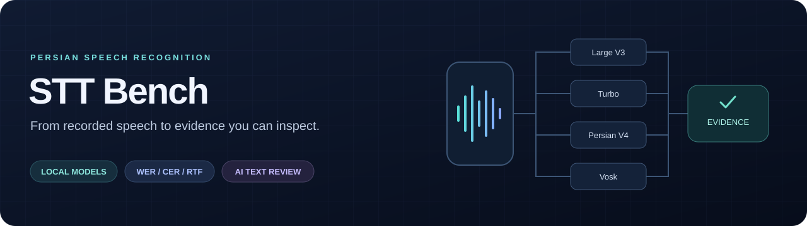
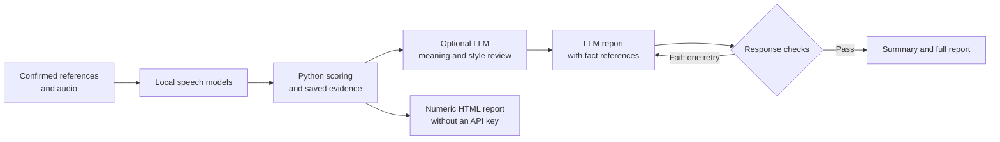
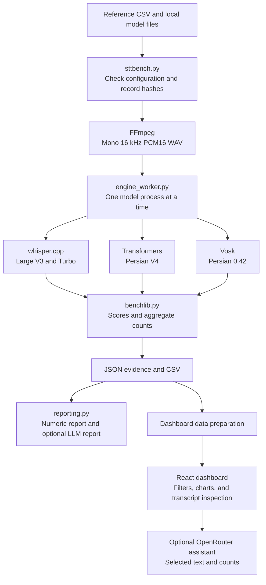

<div align="center">



# Persian STT Bench

**Compare Persian speech recognition with repeatable measurements and an evidence-based AI report.**

`4 model configurations` · `3 dashboard scoring profiles` · `Local speech processing` · `Optional LLM review`

[Workflow](#agentic-workflow) · [Method](#evaluation-method) · [Formulas](#score-formulas) · [Quick start](#quick-start) · [Dashboard](#dashboard) · [Validation](#validation)

</div>

## Agentic workflow

An **agentic workflow** uses an AI model to complete defined tasks inside a controlled process.
In this project, Python runs the speech models and calculates the scores. An optional LLM then reviews the saved transcripts and writes a report.
The program checks the response before it creates the final report.

The LLM has two tasks: assess meaning and style, then explain the measured results.
It receives text evidence. It does not hear recordings, select experiments, change reference text, or calculate benchmark scores.
The workflow uses a fixed sequence of steps. It has no autonomous planning loop.



The report writer must use placeholders such as `{{F:overall.turbo.all.normalized.WER_pct}}` for numeric facts.
Python checks each reference and inserts the saved value.
This check protects numeric values. A human must still check the conclusions.
The report writer has at most two attempts. The qualitative review uses one request.

## Project purpose

**Which model preserves the supplied Persian speech most accurately, and how much processing time does it need?**

This project makes that question open to inspection.
It keeps the reference, each model output, error alignment, timing repetitions, and run settings together.
A reader can move from a comparison table to the transcript that caused an error.

| Part | Question | Evidence |
| --- | --- | --- |
| Recognition | Which words and characters changed? | WER, CER, and word alignment |
| Runtime | How much time and memory did the configured system use? | Median processing time, RTF, and memory records |
| Interpretation | Did the output preserve meaning and spoken style? | Optional LLM labels and written reasons |

The LLM labels are subjective text reviews. They remain separate from the calculated error rates.
No combined score forces accuracy, speed, and meaning into a single ranking.

## System structure



| Model configuration | Engine | Default device | Local input |
| --- | --- | --- | --- |
| Whisper Large V3 | whisper.cpp | CUDA GPU | GGML model file |
| Whisper Large V3 Turbo | whisper.cpp | CUDA GPU | GGML model file |
| Whisper Persian V4 | Transformers | CUDA GPU | Model and processor folder |
| Vosk Persian 0.42 | Vosk | CPU | Extracted model folder |

These are the configurations in `configs/example.json`.
The comparison measures **model, engine, device, and decoding settings together**.
It cannot isolate the effect of model architecture.

## Evaluation method

1. Review each reference against the recording. Set `references_confirmed` to `true`.
2. Check the configuration, dependencies, audio paths, and CUDA access.
3. Save SHA-256 hashes for audio, model files, selected code files, and the native executable.
4. Convert a copy of each recording to mono 16 kHz PCM16 WAV.
5. Load one model in a separate process. By default, run one warmup on the first pending file.
6. Process each file three times by default. Save all outputs and processing times.
7. Score the first output. Use the median time for the runtime comparison.
8. Save per-file results, aggregate scores, and a numeric HTML report.
9. If requested, run the LLM review and create the written report from saved evidence.

The original recordings stay unchanged.
Audio preparation does not remove noise, change volume, or trim silence.
The adapters keep the native model format and saved generation settings.
References are not supplied as recognition prompts. Vosk receives no project grammar.

### Scoring profiles

| Profile | Transform before scoring | Availability |
| --- | --- | --- |
| Raw | Collapse whitespace only | CLI, reports, and dashboard |
| Orthography | Apply the Persian text rules below | Saved as `normalized` in CLI evidence |
| Number-aware | Apply orthography rules and supported number equivalence | Dashboard and reviewed evidence |

Orthography normalization maps Arabic yeh/kaf to Persian letters and digit glyphs to ASCII digits.
It removes Arabic marks, tatweel, and bidirectional control characters.
It converts punctuation, symbols, ZWNJ, and ZWJ to spaces, then collapses whitespace.
CER includes the internal spaces that remain after the selected transform.

The number-aware profile converts supported number words and digit strings to a common form.
It applies number conversion only to the `numbers` and `brackets` categories.
Other categories retain orthography scoring.
For example, `بیست و سه` and `۲۳` both become `23` in those categories.
Leading zeros remain significant. The transform does not repair a wrongly recognized number word.

**The number-aware profile is exploratory.** It was added after inspection of the first run.
It is a text equivalence rule, not proof of correct understanding.
Compare models within the same profile because each profile can change the reference token count.

## Score formulas

### Word error rate

$$
\mathrm{WER}(\%) = 100\,\frac{S+D+I}{N}
$$

Here, $S$ is the number of substitutions, $D$ the deletions, $I$ the insertions, and $N$ the reference word count.
Lower WER is better. Insertions can make WER greater than 100%.

The corpus score uses summed counts:

$$
\mathrm{WER}_{\mathrm{corpus}}(\%) = 100\,\frac{\sum_j(S_j+D_j+I_j)}{\sum_j N_j}
$$

It is not the mean of per-file percentages.
For example, one error in two reference words and one error in eight words give a corpus WER of 20%.
The mean of the two file rates would be 31.25%.
This example explains the calculation; it is not a measured project result.

### Character error rate

$$
\mathrm{CER}(\%) = 100\,\frac{S_c+D_c+I_c}{N_c}
$$

The subscript $c$ identifies character counts.
Corpus CER also uses summed error and reference counts.

### Processing time and real-time factor

$$
t_j = \operatorname{median}(t_{j,1},\ldots,t_{j,R}),
\qquad
\mathrm{RTF} = \frac{\sum_j t_j}{\sum_j a_j}
$$

$R$ is the repetition count. $a_j$ is the prepared audio duration in seconds.
An RTF below 1 means processing was faster than the audio duration.
Timing includes WAV reading, feature extraction, and decoding.
For whisper.cpp, it also includes the local HTTP request.
Model loading, warmup, and audio conversion are excluded.

### Exact match and completion

$$
\mathrm{Exact}(\%) = 100\,\frac{\text{exact transcripts}}{\text{completed files}},
\qquad
\mathrm{Completion}(\%) = 100\,\frac{\text{completed files}}{\text{expected files}}
$$

Exact match uses the selected text transform.
A failed or missing output has no WER score. It is not treated as a correct transcript.
If completion differs, use the common-file comparison to compare the same recordings across models.

## Quick start

### 1. Install the environment

Use Windows x64, Python 3.12, FFmpeg on `PATH`, and local model files.
The default CUDA configuration needs an NVIDIA GPU.
GGML models also need `whisper-server.exe` and its matching DLL files.
The recorded GPU package is PyTorch `2.8.0+cu129`; other GPU builds have not been verified here.

Run these commands in the repository folder with PowerShell:

```powershell
py -3.12 -m venv .venv
.venv\Scripts\python.exe -m pip install "torch==2.8.0+cu129" --index-url https://download.pytorch.org/whl/cu129
.venv\Scripts\python.exe -m pip install -r requirements.txt
Copy-Item configs/example.json configs/local.json
```

Python dependencies and model weights are separate.
The benchmark does not download weights. Set model and executable paths in `configs/local.json`.
Paths can be absolute or relative to the repository folder.
Keep the whisper.cpp DLL files beside its executable.

### 2. Prepare the reference CSV

Create `data/references.csv`. Audio paths are relative to the CSV file.

```csv
id,file_name,reference,category,speaker_id,prompt_id
sample-01,audio/sample-01.wav,سلام دنیا,custom,speaker-01,prompt-01
```

Use a unique recording ID and audio path for each row.
References must contain text after normalization.
The category, speaker, and prompt fields support grouped comparisons.
After you check the references, set `references_confirmed` to `true` in the configuration.

### 3. Check and evaluate

```powershell
.venv\Scripts\python.exe sttbench.py check --config configs/local.json
.venv\Scripts\python.exe sttbench.py run --config configs/local.json
```

For a first test, use one configured model and one recording:

```powershell
.venv\Scripts\python.exe sttbench.py run --config configs/local.json --model vosk --only-file sample-01 --repeats 1
```

The program prints the result folder. Replace `RUN-ID` below with that folder name.
To resume a run, keep the inputs, selection, packages, code, and settings unchanged:

```powershell
.venv\Scripts\python.exe sttbench.py run --config configs/local.json --resume results/RUN-ID
```

Repeat any selection or repetition options from the original command.
The run signature rejects changed inputs. Successful files are reused.
The environment check confirms imports and basic GPU access. It does not prove that every model fits in memory.
The benchmark does not switch automatically to CPU or lower precision after a memory error.

### 4. Create the optional AI report

Copy `.env.example` to `.env`. Enter `OPENROUTER_API_KEY` and set `OPENROUTER_MODEL` explicitly.
The example file selects `deepseek/deepseek-v4-pro`; reporting code has a different fallback when this variable is absent.

```powershell
Copy-Item .env.example .env
# Edit .env before the next command.
.venv\Scripts\python.exe sttbench.py report --run results/RUN-ID
```

This command first requests a qualitative review, then requests the report.
It sends reference text, predictions, metadata, and measured evidence to OpenRouter.
Audio files and model weights stay local.
The report can be generated from saved results without another STT run.
Without an API key, open `results/RUN-ID/numeric-report.html`.

## Dashboard

The React dashboard shows saved results in English or Persian.
It provides model and category filters, scoring profiles, comparison charts, CSV export, and transcript inspection.
Word alignment shows substitutions, deletions, and insertions for the selected profile.
An optional assistant answers questions from the selected text and counts.
Local facts mode works without an API key.

For an existing dashboard build and its prepared data, start the local server:

```powershell
.venv\Scripts\python.exe dashboard_server.py
```

Open [the local dashboard](http://127.0.0.1:8765). The server listens on this computer only.
A new CLI run does not automatically update the dashboard.
The importer rebuilds dashboard scores from saved references and predictions.

See [DASHBOARD.md](DASHBOARD.md) for data import, build requirements, API settings, and interface limits.
A fresh clone needs data preparation and a dashboard build.
The current refresh helper uses the Codex Data build runtime and an existing `dashboard/src/data.json` file.
It is not a complete first-build installer.

## Output files

| File in a run folder | Purpose |
| --- | --- |
| `run.json` | Configuration, hashes, environment, and run signature |
| `dataset.json` | Prepared audio metadata and source hashes |
| `<model-id>/attempts.json` | Status, repeated predictions, and processing times |
| `<model-id>/engine.json` | Engine settings, loading time, and memory records |
| `evidence.json` | Measured evidence used by reports |
| `metrics.json` | Overall, category, speaker, and common-file scores |
| `per-file.csv` | Per-file results; review rewrites this export with review fields |
| `numeric-report.html` | Complete numeric report without an LLM summary |
| `reviewed-evidence.json` | Optional meaning labels and number-aware scores |
| `qualitative-review.json` | Optional review labels and API metadata |
| `agent-authored-report.json` | Optional validated report with fact placeholders |
| `report.md` / `report.html` | Optional written analysis and full HTML report |
| `index.html` | Result page with report download links |
| `validation.json` | Saved validation checks, when requested |

## Validation

Run the existing scoring, number-profile, and report-flow tests:

```powershell
.venv\Scripts\python.exe -m unittest discover -s tests -v
```

To check a saved run against its counts, timing medians, and model hashes:

```powershell
.venv\Scripts\python.exe tools/validate_run.py results/RUN-ID
```

This command recalculates scores and aggregate results, checks model/file pairs, and verifies unchanged model files.
It needs access to those model files.
Passing software checks does not validate reference text by listening or establish statistical significance.

## Limits of the comparison

- The recorded study uses a small dataset from two speakers. Paired readings share prompts.
- These results cannot establish general Persian accuracy or a difference between speaker populations.
- Reference text is confirmed by the user. The program does not independently verify it against the audio.
- Engines, devices, precision, and decoding defaults differ. Speed results describe the full configured system.
- Process RAM is sampled every 100 ms. Short peaks can be missed.
- PyTorch GPU allocation and process RAM measure different resources. They do not give a common GPU memory ranking.
- Meaning and style labels come from one text-only reviewer. They are not validated objective scores.
- Minimum-edit word alignment identifies text differences. It does not identify the acoustic cause of an error.
- No significance test or weighted composite score is used.

## Source map

```text
.
|-- sttbench.py             # CLI and run control
|-- engine_worker.py        # Local speech engine adapters
|-- benchlib.py             # Audio preparation and deterministic scoring
|-- number_profile.py       # Exploratory numeric equivalence
|-- reporting.py            # Numeric reports and optional LLM workflow
|-- dashboard_server.py     # Local dashboard and assistant server
|-- configs/example.json    # Four model configurations
|-- dashboard/              # React interface
|-- docs/                   # Documentation assets and saved site files
|-- tests/                  # Existing validation tests
|-- tools/                  # Run validation and dashboard preparation
|-- data/                   # Local recordings and references
`-- results/                # Local run evidence and reports
```

Model weights, recordings, local references, keys, environments, and run folders are excluded from Git by default.
Check dataset permissions and model licenses before you share a result.
